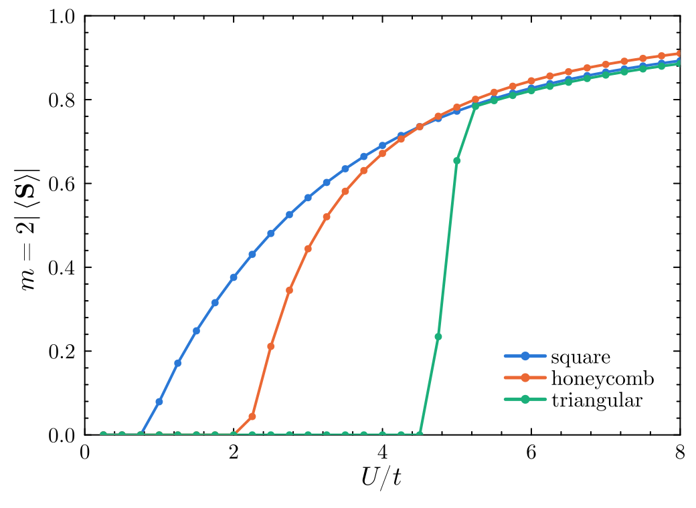
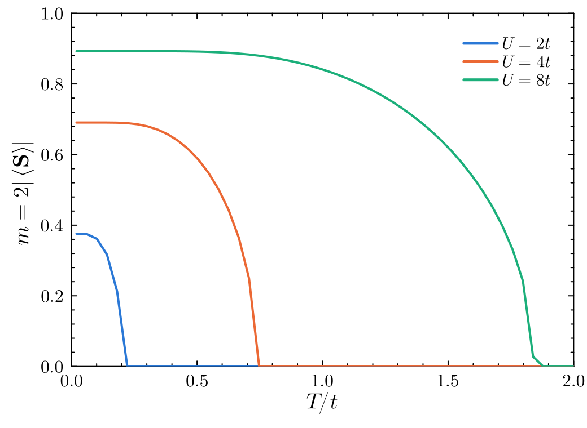
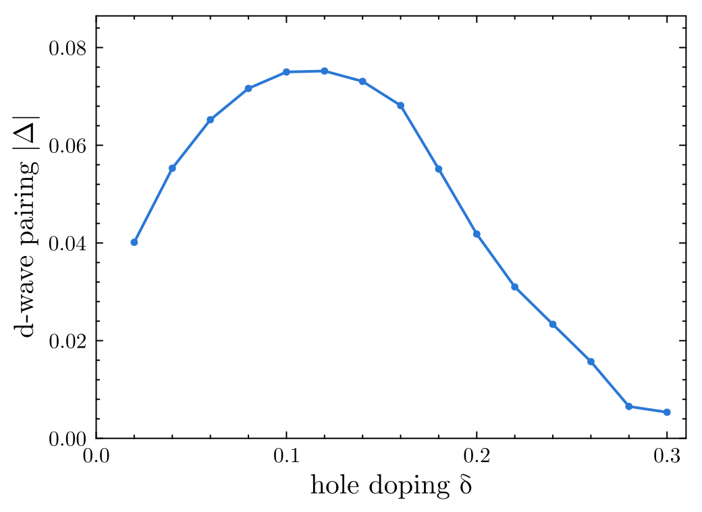
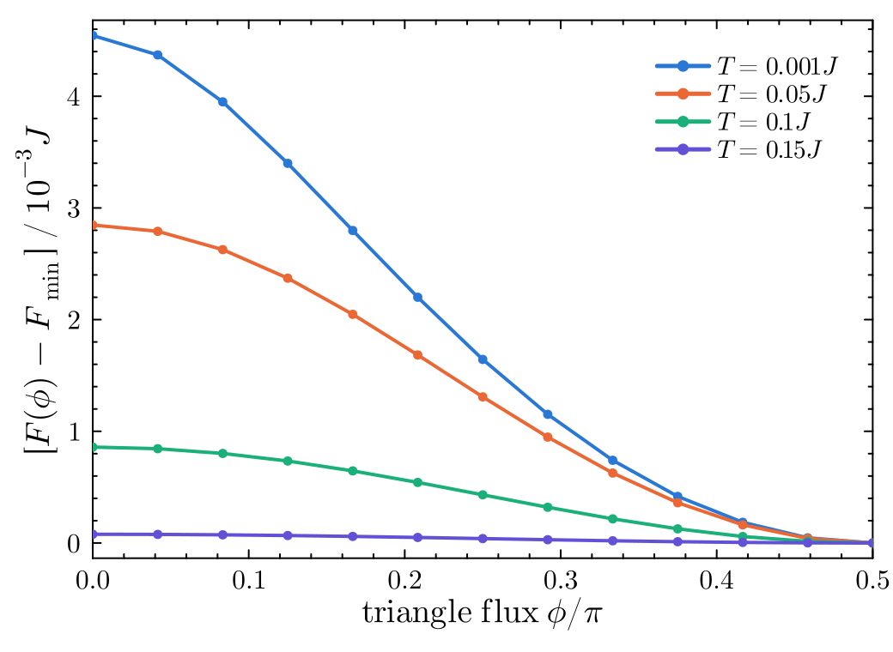

# MeanFieldToolkit.jl

[](https://github.com/Toronto-Condensed-Matter-Theory/MeanFieldToolkit.jl/actions/workflows/CI.yml?query=branch%3Amain)
[](https://Toronto-Condensed-Matter-Theory.github.io/MeanFieldToolkit.jl/dev/)

MeanFieldToolkit.jl solves self-consistent mean-field equations for interacting fermions on a lattice.
You give it a tight-binding model, a set of two-site interactions and the order parameters to track; it decouples the interactions, iterates to self-consistency and returns the mean-field state with its energy and free energy.
Hopping and pairing (BdG) order parameters are both supported, at zero and finite temperature.

## Installation

MeanFieldToolkit is registered in the General registry.
In the Julia REPL, press `]` to enter package mode and run

```julia
add MeanFieldToolkit
```

## Quick start

Néel order in the half-filled Hubbard model on the square lattice, with U = 4t:

```julia
using MeanFieldToolkit, TightBindingToolkit

# Square lattice in a √2 × √2 cell (two sites); spin-1/2 fermions with nearest-neighbour hopping -t
uc = UnitCell([[1.0, 1.0], [1.0, -1.0]], 2, 2)
AddBasisSite!(uc, [0.0, 0.0])
AddBasisSite!(uc, [1.0, 0.0])
σ = SpinMats(1 // 2)                                      # [Sx, Sy, Sz, Id]
t = Param(-1.0, 2)
AddIsotropicBonds!(t, uc, 1.0, σ[4], "t")
CreateUnitCell!(uc, [t])

# On-site Hubbard interaction U n↑n↓
U = Param(4.0, 4)
AddIsotropicBonds!(U, uc, 0.0, DensityToPartonCoupling([1.0 0.0; 0.0 0.0], [0.0 0.0; 0.0 1.0]), "Hubbard")

# Order parameters: the Sz channel on each site
orders = Param{2, Float64}[]
for site in 1:2
    Sz = Param(1.0, 2)
    AddAnisotropicBond!(Sz, uc, site, site, [0, 0], σ[3], 0.0, "Sz on site $(site)")
    push!(orders, Sz)
end

bz = BZ([33, 33]); FillBZ!(bz, uc)
H = Hamiltonian(uc, bz); DiagonalizeHamiltonian!(H)
mft = TBMFTModel(Model(uc, bz, H ; T = 0.01, filling = 0.5), orders, [U], IntraQuarticToHopping)

sc = SolveMFT!(mft, [0.5, -0.5] ; max_iter = 200, tol = 1e-8)
sc.VOuts[end]          # ≈ [0.69, -0.69]: 2⟨Sz⟩ on the two sites
mft.MFTEnergy[end]     # mean-field energy per site, ≈ -1.797t
```

## Features

- **Any lattice.** Lattices, unit cells and hoppings come from [TightBindingToolkit.jl](https://github.com/Toronto-Condensed-Matter-Theory/TightBindingToolkit.jl), so any lattice in $d = 1, 2, 3$ works.
- **Any two-site interaction.** Interactions are rank-4 arrays on bonds. Builders cover the common four-fermion terms: `DensityToPartonCoupling` (Hubbard and density-density) and `SpinToPartonCoupling` (Heisenberg and other spin-spin couplings).
- **Hopping and pairing orders.** `TBMFTModel` tracks hopping order parameters; `BdGMFTModel` adds pairing. On-site and inter-site decouplings are built in (`IntraQuarticToHopping`, `InterQuarticToHopping`, `InterQuarticToPairing`, …), and you can supply your own.
- **Energies and finite temperature.** `GetMFTEnergy`, `GetMFTEntropy` and `GetMFTFreeEnergy` return the mean-field energy, entropy and free energy F = E − TS per site, for comparing phases at T > 0.
- **Configurable solver.** Self-consistency runs through [FixedPointToolkit.jl](https://github.com/Toronto-Condensed-Matter-Theory/FixedPointToolkit.jl), with Anderson mixing by default. The update method, tolerance and maximum number of iterations are all options.
- **Checkpoints.** Runs can save to JLD2 files and resume from them (`ResumeMFT!`, `ReadMFT`). By default only the final state is saved; `debug = true` keeps the full history of every iteration.
- **Plotting.** `PlotMFT!` and `PlotMFTEnergy!` plot the order parameters and the mean-field energy against iteration.

## Gallery

<table>
<tr>
<td width="50%"><br><em>Half-filled Hubbard model: the magnetic moment sets in at small U on the square lattice (perfect nesting), and only above a critical U on the honeycomb (Néel) and triangular (120° order) lattices. T = 0.01t.</em></td>
<td width="50%"><br><em>Néel moment of the square-lattice Hubbard model against temperature; it vanishes at the Hartree-Fock Néel temperature.</em></td>
</tr>
<tr>
<td width="50%"><br><em>Slave-boson t-J model on the square lattice (J = 0.3t): d-wave spinon pairing against hole doping. Below δ ≈ 0.17, coexisting antiferromagnetism suppresses the pairing.</em></td>
<td width="50%"><br><em>Kagome Heisenberg model: free energy of fermionic-spinon states with flux [ϕ, ϕ, π − 2ϕ], from the Dirac spin liquid (ϕ = 0) to the chiral spin liquid (ϕ = π/2).</em></td>
</tr>
</table>

Every calculation is unrestricted: all spin (and, for t-J, pairing) channels on every site and bond are free order parameters.
To regenerate the figures, run `julia --project=docs/readme docs/readme/figures.jl` from the repository root.

## Examples

The [`Sample`](Sample) folder has unrestricted mean-field examples of the Hubbard, Heisenberg (fermionic spinons) and slave-boson t-J models on the square, triangular, honeycomb and kagome lattices, including finite temperature.
`Sample/MinimalExamples` holds short standalone scripts, and `Sample/Notebooks` holds one Pluto notebook per lattice.
See [`Sample/README.md`](Sample/README.md).

## Documentation

For details, see the [documentation](https://Toronto-Condensed-Matter-Theory.github.io/MeanFieldToolkit.jl/dev/).

## Related packages

| Package | Purpose |
|:--|:--|
| [TightBindingToolkit.jl](https://github.com/Toronto-Condensed-Matter-Theory/TightBindingToolkit.jl) | Lattices, tight-binding and BdG Hamiltonians, band structures and response |
| [FixedPointToolkit.jl](https://github.com/Toronto-Condensed-Matter-Theory/FixedPointToolkit.jl) | Fixed-point iteration and mixing schemes for self-consistent equations |
| [MeanFieldToolkit.jl](https://github.com/Toronto-Condensed-Matter-Theory/MeanFieldToolkit.jl) | Self-consistent mean-field theory of interacting lattice models |
| [RPAToolkit.jl](https://github.com/Toronto-Condensed-Matter-Theory/RPAToolkit.jl) | Random phase approximation: instabilities and collective modes |
